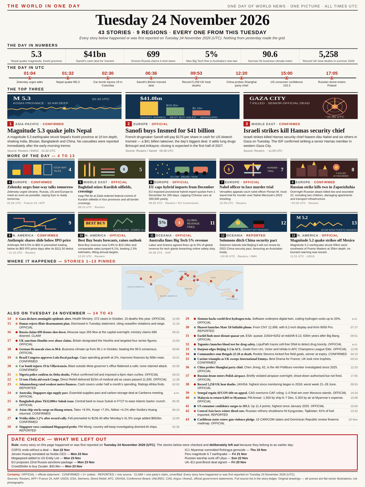

# The World in One Day — Tuesday 24 November 2026

[](https://make.fun/bounty/news-image-20261124)
[](https://make.fun/bounty/news-image-20261124)
[](https://make.fun/bounty/news-image-20261124)

One image that sums up the world's news of **Tuesday 24 November 2026** — 35 stories from 6 regions, every one of them happened or was first reported that day (UTC). Built for the [make.fun news-image bounty](https://make.fun/bounty/news-image-20261124) ($100, top 50 share).



## What's in the picture

- **Masthead** — the day in giant type: Tuesday 24 November 2026.
- **The day in numbers** — 5.3 (Nepal quake), $41bn (Sanofi buys Insmed), 699 (drones Russia claims down), 5% (Australia's Big Tech fine), 90.6 (German Ifo index), 272 (meningitis cases in Gaza).
- **The day in UTC** — an 8-event timeline, 01:04–11:51.
- **The top three** — Nepal M5.3 quake, Sanofi's $41bn Insmed deal, Israeli strikes kill a Hamas security chief — each with a flat vector illustration.
- **More of the day (4–13)** — ten small cards with mini illustrations, then a pinned world map and the full 14–35 list.
- **DATE CHECK** — the red box lists the stories deliberately left out because they belong to an earlier day (COP31, Huang's Nvidia return, EU sanctions, CrowdStrike–Zscaler, the ICJ Myanmar ruling, the Peru quake, the Libya warship, the UK–EU deal), so the judge can see the one-day discipline.
- **Sources** — Reuters, AFP / France 24, AAP, USGS, ESA, Siemens, Direct Relief, AFC, official government statements. The full source ledger is in `story-ledger.md`.

## How it was made

`broadsheet.html` is the source (fixed 2400×3200 canvas, editorial broadsheet style); `render.mjs` renders it to PNG with Playwright/Chromium. The submitted `entry.png` is the same image downscaled to 768×1024 so it fits the gate (at most 1 MiB, at most 1024×1024 pixels). `story-ledger.md` records every story with its source URL and verification note.

## Run it

```sh
node main.ts
```

`main.ts` (Node 22, standard library only) validates `entry.png` — PNG magic, dimensions within 1024×1024, size within 1 MiB, IEND chunk present — then copies it to `/output/entry.png` (or `$MAKEFUN_OUTPUT_DIR/entry.png` outside the grader). The output is byte-identical to `entry.png`.

## License

MIT — see `LICENSE`.
